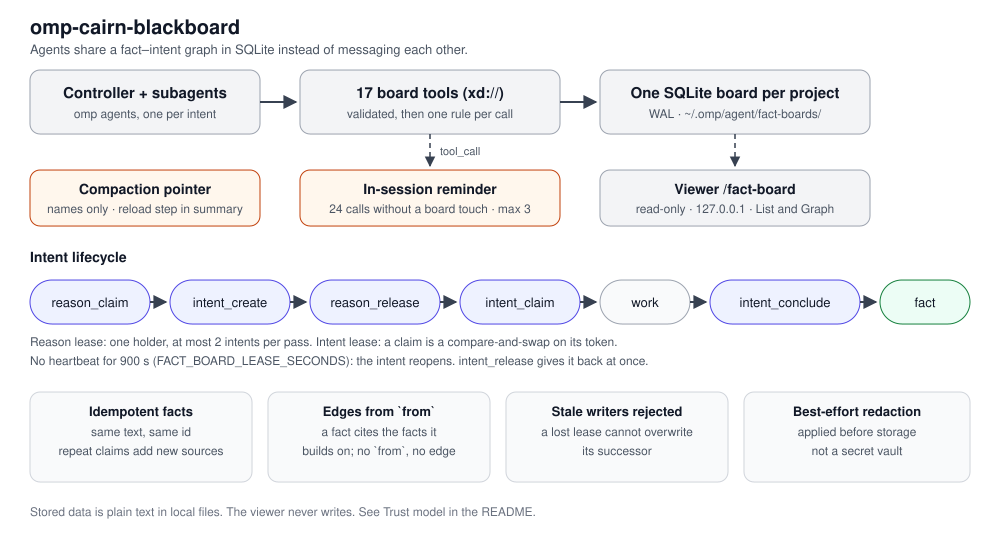
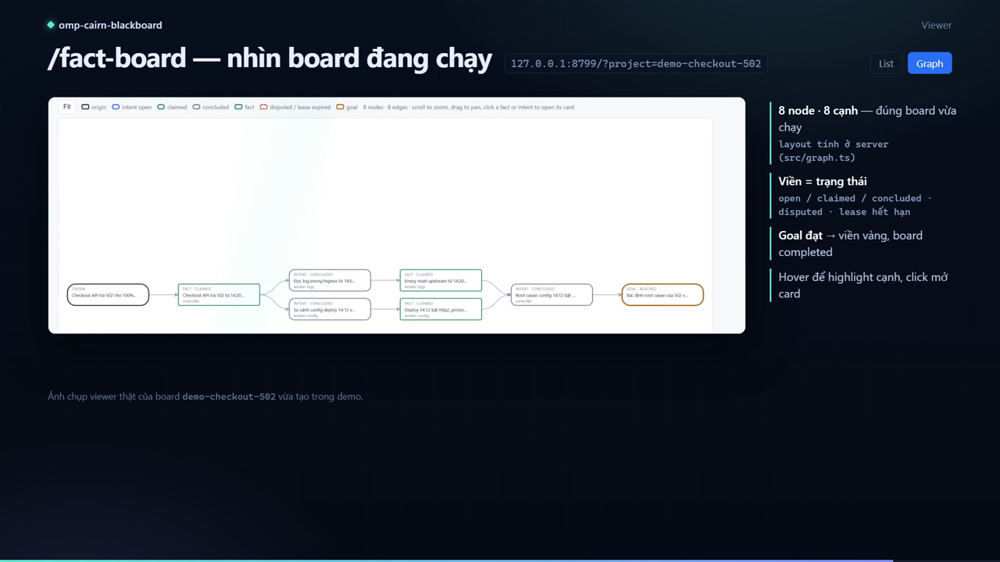

# omp-cairn-blackboard

A state-space-search **blackboard** for omp (oh-my-pi). It gives parallel subagents a shared, persistent, queryable graph to coordinate through, instead of each one re-deriving the same findings. The design is inspired by [Cairn](https://github.com/oritera/Cairn)'s idea that *state is the single source of truth* and *decisions are distributed to workers*; it is an independent implementation and contains no Cairn code.



| Piece | What it is |
|---|---|
| **Fact board** (extension) | Seventeen tools implementing a fact–intent graph: `board_init`, `board_list`, `board_export`, `board_complete`, `board_reopen`, `fact_claim`, `fact_query`, `fact_dispute`, `reason_claim`, `reason_release`, `intent_create`, `intent_claim`, `intent_heartbeat`, `intent_conclude`, `intent_release`, `hint_write`, `hint_query`. `board_list` is how a new session finds the board of unfinished work. |
| **`cairn-search`** (skill) | The loop: Init → Bootstrap → Reason → Explore → Converge, for problems whose path is unknown up front. |
| **`dispatcher-check`** (skill) | Diagnose whether the light dispatcher is firing its `cairn-dispatch` advice (open intents / Reason passes) and whether expired claims project as reclaimable. |
| **`update-version`** (skill) | Bump the plugin version: `package.json`, `bun test`, docs, commit/push. |
| **`/fact-board`** (command) | A read-only live view of the graph, for watching long multi-subagent investigations. |
| **`redact-output`** (optional feature) | Rewrites credential-shaped values in command/execution output (`bash`, `eval`) before it reaches the transcript. File reads and searches are left untouched. Off by default. |

> **Skill name collision:** skills are discovered at session startup. If a skill named `cairn-search` already exists in `~/.omp/agent/skills/` (an earlier manual copy), the plugin's copy is namespaced to `omp-cairn-blackboard/cairn-search`. Verify with `omp skill list --json` in a fresh session after install; delete or rename the stale copy to keep the bare name.

## Demo

[](https://youtu.be/p7SJtOuVJnc)

Watch on YouTube: <https://youtu.be/p7SJtOuVJnc> · 178 seconds, 1080p, no narration. GitHub does not embed a player in a README, so the poster links out.

It runs one real board from `origin` to `goal` — init, a first fact, the Reason lease, two intents, two workers, a refused claim, a hint, two conclusions, completion — then shows the dispatcher advice those states trigger and the `/fact-board` list and graph views of the finished board. The same file is in [`docs/omp-cairn-blackboard-demo.mp4`](docs/omp-cairn-blackboard-demo.mp4).

## The graph

The board is a directed graph from `origin` (what is known) to `goal` (the success condition):

```
origin ──► Intent ──► Fact ──► Intent ──► Fact ──► … ──► goal
```

- A **fact** is a confirmed finding. It is produced by concluding an intent (which records the edge), or claimed directly while bootstrapping.
- An **intent** is a step into the unknown. It cites the facts it grows from (`from`) and, when concluded, yields exactly one fact (`to`). Edges are stored, so the path from origin to goal is auditable.
- A **hint** is human steering, delivered to workers when they claim an intent and included in every export.

## Install

```bash
# from the marketplace (this repository is its own catalog)
omp plugin marketplace add duhd/omp-cairn-blackboard
omp plugin install omp-cairn-blackboard@omp-cairn-blackboard

# from git
omp plugin install github:duhd/omp-cairn-blackboard

# with the optional output-redaction feature
omp plugin install "github:duhd/omp-cairn-blackboard[redact-output]"

# from a local checkout (development)
omp plugin link ./omp-cairn-blackboard
omp plugin features omp-cairn-blackboard --enable=redact-output   # opt into output redaction
```

Quit omp and start it again (`/new` does not load new extensions). The tools then exist for every session and subagent. Check with `omp plugin list`. Use one install method: omp rejects a second install under the same package name.

### Updates

When a main session starts, the plugin compares its version with `package.json` on `main` (at most once a day; the result is cached in `omp-cairn-blackboard-update.json` next to the default board). If `main` is newer, it shows a notice with the command for your install method. It never updates by itself:

| Installed with | Suggested command |
|---|---|
| marketplace | `omp plugin marketplace update <marketplace>` then `omp plugin upgrade omp-cairn-blackboard@<marketplace>` |
| `github:` | `omp plugin upgrade omp-cairn-blackboard` (keeps enablement and features; a fresh `install` resets them) |
| `omp plugin link` of a git checkout | `git pull` in the checkout |

Offline or failed checks are silent. Set `FACT_BOARD_UPDATE_CHECK=0` to turn the check off. Release notes: [CHANGELOG.md](CHANGELOG.md).

> omp mounts extension tools under `xd://` rather than in the normal tool list. Agents call them by writing a JSON args object to `xd://fact_claim` (read the same path for the schema). The `cairn-search` skill tells the agent this, and tells it to repeat it to subagents.

## Use

Ask the agent to investigate something open-ended with `cairn-search`, or drive the tools directly:

1. `board_init({ origin, goal })`.
2. **Bootstrap** — try to solve it directly; `board_complete` if solved.
3. **Reason** — `reason_claim`, then `board_export` (the whole graph). Propose up to two `intent_create`, then `reason_release`.
4. **Explore** — one `task` subagent per open intent: `intent_claim` → work → `intent_conclude` with `evidence` (required), or `intent_release` to hand it back. Brief the worker with a path, not a transcript: write the export once to `local://board-<project>.md` and pass that path plus the intent id.
5. Repeat, then synthesize from `board_export`.

### Coordination rules (enforced in code, not just in prompts)

- `intent_create` needs the Reason lease (`reason_claim` → `reason_token`), and one pass may declare at most **2** intents.
- `intent_claim` returns a **lease token**. `intent_heartbeat`, `intent_conclude` and `intent_release` are compare-and-swap on that token: a worker whose lease was reclaimed can never overwrite its successor, and its rejected `intent_conclude` creates no fact. The token guards against races and stale writers among cooperating agents; it is not authentication (see [Trust model](#trust-model)).
- `intent_claim` also returns the newest 10 hints plus `hint_count`, the board total. When `hint_count` is larger, the worker saw only the newest slice and should read the rest before deciding.
- A claimed intent whose lease goes stale can still be concluded by its owner — the lease only lapses when it is actually reclaimed — and a new worker reclaims it on `intent_claim`, so a dead subagent never wedges the board.
- Rejections are structured: tool errors carry a `code` (`intent_claimed`, `lease_lost`, `invalid_transition`, `reason_held`, …) plus `held_by` and `lease_expires_at` when a lease is involved, so a worker can tell a transient refusal from a permanent one.
- `fact_claim` is idempotent (same text → same id; a repeat claim keeps the first row and adds any new `from` ids). `from` lists the facts it builds on (`"origin"` for the first), which draws its edges in the graph; without it the fact floats unconnected. `fact_dispute` marks a fact wrong; disputed facts cannot be cited as sources.

- Two results carry health signals instead of refusing: `fact_claim` adds `warnings` when the fact has no worker name (it is attributed to the Reason-lease holder, or `unknown` when no lease is held) or no `from` (it would float), and `board_complete` adds `unfinished`, the intents still open or claimed when the board was closed. Completion is not blocked, matching Cairn, so a board can still close over an abandoned question — but the result says so.
- `reason_claim` returns a `board` summary (fact and edge count, open and claimed intents, floating and unknown counts, hints), so a Reason pass has the graph in hand without a separate `board_export`.
- `reason_release` after `board_complete` is not an error: completion already released the lease, so the release returns `{ released: false, note }` instead of failing.
- `board_init` warns (`overlapping` + `warning`) when the new project shares its leading name family with an existing active board — e.g. `ghsa-w4c7-impact`, `ghsa-w4c7-backport` and `ghsa-w4c7-prod` are one task. It only warns, never refuses; the heuristic does not flag distinct tasks such as `litellm-bump` vs `litellm-hni`.

### After a compaction

Compacting a session rewrites the conversation, and with it the project and worker names the agent was using. The extension notes (per session, in process memory) which projects each session wrote to and which worker names it claimed with, and on `session.compacting` hands the summarizer one short block: the project and worker names, and a required first step: `board_export` (timeline) for each board, then `intent_claim` again with the same worker name on any intent still held, which returns the lease token. Only names that match the project/worker name rules are included, never board text. Subagents are tracked under their own session ids, so a parent's summary lists only the boards the parent itself called. This is a nudge inside the summary, not a guarantee the next turn follows it.

### In-session reminder

The board records nothing by itself, and an agent deep in a task can forget to create, read or write to it. To catch that, the extension watches the main session's tool calls and, when it makes **24 tool calls without writing to the board**, injects one `cairn-nudge` message that says to create the board (or `board_export` the one it is on), record milestones with `fact_claim`, and declare an intent before a system-changing step. It then waits a **10-minute cooldown** and stops after **3 nudges per session**. Only write tools (`board_init`, `fact_claim`, `intent_*`, `hint_write`, `board_complete`) reset the counter; read tools (`board_export`, `fact_query`, `board_list`) do not, so a session that only reads is still nudged. Subagents are never nudged. The thresholds are constants in `src/session-boards.ts` (`NUDGE_AFTER_CALLS`, `NUDGE_COOLDOWN_MS`, `MAX_NUDGES_PER_SESSION`); there is no environment variable to turn them off yet.

### Light dispatcher

Cairn's dispatcher decides what runs next; inside omp only the agent can spawn subagents, so this extension advises the main session instead (`src/dispatch.ts`). At most every 30 s, on a main-session tool call, it reads each active board the session has used and compares it with its last look, using Cairn's triggers:

- **open intents nobody has claimed** → one `cairn-dispatch` message asking for one `task` subagent per intent, each with its own worker name. An intent is announced once while it stays open, including intents already open when a session resumes a board; one that goes back to open (`intent_release`, or an expired lease) is announced again;
- **more facts or hints, or the last open intent concluded** → a message asking for a Reason pass (`reason_claim`, `board_export`, then `board_complete`, which releases the Reason lease itself, or `intent_create` + `reason_release`). It carries the delta that fired it and the absolute totals (`Board now: N fact(s), M hint(s), K live intent(s)`). While any worker still holds an intent this prompt waits, then fires once they have all finished, so the controller does not close the board on half the results.

Messages carry only counts, short intent ids and the project name, never board text. A board that cannot be read, or a message that cannot be sent, is skipped: the hook never blocks a tool call. Subagents get no advice.

## Watching the board

`/fact-board` starts a read-only viewer in-process (default `http://127.0.0.1:8799`); `/fact-board stop` and `/fact-board status`. It refreshes every 2 s and has two tabs:

- **List**: a summary of the board (status, origin, goal, Reason lease and graph-health flags), a chip per worker that filters the board, facts, intents by status with their `from → to` edges, and hints. Stale leases are marked and new rows are highlighted.
- **Graph** (`?view=graph`): the board drawn left to right, from `origin` through intents and facts to `goal`. Border colors show status: intents are open, claimed or concluded; facts are claimed or disputed; an expired lease gets a red dashed border; a reached goal gets a solid gold border. Scroll to zoom, drag to pan, **Fit** to reset. Hover a node to highlight its edges, and click a fact or intent to open its card in List. The filter box dims nodes that don't match. A dashed edge that loops back means a finding deduplicated into an earlier fact. Zoom and pan are kept across refreshes. The layout is computed server-side (`src/graph.ts`).

The page follows the system light or dark theme, loads nothing from the network, and `/` focuses the filter box.

Use the project picker to switch boards; the URL keeps `project` and `view`. Boards marked `completed` are hidden from that picker by default, and the board named in the URL always stays listed, so a link to a finished board still opens. Toggle **Show completed** beside the picker to show them.

Outside omp, run the viewer from anywhere (it takes no arguments and reads the boards under `~/.omp/agent`):

```bash
bun "$HOME/omp-cairn-blackboard/src/viewer.ts"
```

The board summary also flags graph health: facts that cite no source and were produced by no intent (*floating*), and facts recorded without a worker name (*unknown provenance*).

The viewer reads the newest 500 facts, 500 intents and 500 hints. When older facts or intents exist, both tabs mark the view as **partial**: older nodes, and the edges into them, are not shown. When only hints overflow, just the List tab is marked, since the graph does not draw hints. Use `board_export` for the full graph.

The viewer opens the database read-only, binds to `127.0.0.1` only, answers only GET/HEAD, checks the `Host` header, and renders board text (HTML and SVG) with `textContent` only.

## Configuration

| Variable | Default | Meaning |
|---|---|---|
| `FACT_BOARD_DB` | `<agent dir>/fact-board.db` | Default board file. Point it at a per-project file to keep investigations apart. |
| `FACT_BOARD_PORT` | `8799` | Viewer port. |
| `FACT_BOARD_LEASE_SECONDS` | `900` | How long an intent/Reason lease may go without a heartbeat before it can be reclaimed. |
| `FACT_BOARD_MAX_INTENTS` | `2` | Cap on intents one Reason pass may declare. |
| `FACT_BOARD_UPDATE_CHECK` | on | `0` disables the daily new-version check against GitHub. |
| `PI_CODING_AGENT_DIR` | `~/.omp/agent` | Used to locate the default board. |

Each tool also takes an optional `project` name: every project is its own board file (under `fact-boards/` next to the default), with its own origin, goal and graph.

### Advisors (optional)

The plugin installs no advisor. Advisor discovery reads `WATCHDOG.yml` from the agent directory (`~/.omp/agent`) and from each directory between the cwd and the repository root; the plugin cache is not one of those places, so `omp plugin install` and `omp plugin upgrade` never add or change an entry.

`docs/advisors/board-auditor.yml` is a ready entry that audits a board instead of the code. Paste its single list item under the `advisors:` key of your own `WATCHDOG.yml`, keep its two-space indentation, and parse the file before starting a session:

```bash
${EDITOR:-vi} ~/.omp/agent/WATCHDOG.yml     # keep your existing entries
omp -p --advisor "ok"                       # a broken roster warns at startup and is skipped
find ~/.omp/agent/sessions -name '__advisor.board-auditor.jsonl'
```

A valid file only proves the YAML parses; `/advisor status` in the session lists the entries that actually built, and a malformed roster is reported and skipped at startup instead of failing silently.

Sequence entries in one `advisors:` list must align. The snippet is indented two spaces to match the roster examples; if your file aligns differently, re-indent the whole item, because a level mismatch is a YAML error that drops the whole roster rather than just the new entry.

- Read-only: `read`, `grep`, `glob`. It queries the board with `read <db>?q=SELECT ...` and needs no shell, so board text never reaches a command line.
- `scope: main`: attached to the top-level session only, never to the Cairn subagents that hold intents.
- `reviewMode: agent-end` with `reviewInterval: 3`: one review per three completed runs. A roster entry ignores the global `advisor.reviewInterval` and defaults to `1`, which pays a review at every final yield of every main session whether or not it touched a board. Raise the interval, or drop the entry, if that cost is not worth it; the `advisor` model role pays for it.
- The instructions treat facts, evidence and hints as data, keep the reviewer away from shell tools, and tell it to stay silent in sessions that never use a board.

## Security notes

### Trust model

**Single-tenant, local trust.** The board assumes every agent and person who can reach it is the same trusted user on the same machine.

- There is no per-worker authentication. A `worker` name is a label, not an identity: calling `intent_claim` again with the name that currently holds an intent returns that lease's token (that is how a worker whose context was compacted recovers it), and `claimed_by` is visible through `board_export` and the viewer. Anyone who can read the board can therefore take over, conclude or release another worker's intent.
- Anyone who can open the database file can read and change everything in it directly; the tools add no access control on top of the file's permissions.
- The viewer is read-only and binds to loopback only (with a `Host` header check), but it shows the whole board to any local process or user that can reach that port.
- Do not share one board between mutually untrusting agents, users or tenants, and do not expose the viewer or the database file over a network or a shared volume. Use a separate `project` (a separate database file) per trust boundary.

### Stored data

- The database is shared by every project that uses the same agent directory, and findings are stored in plain text. For sensitive work set `FACT_BOARD_DB` (or pass `project`) to keep data apart, and keep the file out of backups and sync.
- Facts, evidence, dispute reasons, intents and hints are passed through best-effort credential redaction **before** they are stored. It is regex-based: it catches common shapes (`password=…`, `*token` / `*Token` keys, `*_secret`, API keys, `Bearer …`, AWS key ids, common provider tokens, private-key blocks), not arbitrary secrets. Do not treat the board as a safe place for credentials.
- The `redact-output` feature applies the same rules to command/execution output (`bash`, `eval`) only. Reading or searching files (`read`, `grep`, `glob`, `find`) is not redacted, because rewriting source code corrupts what the agent sees; a file that contains a secret is therefore not masked by this feature. Output of a `bash` command that runs in the background (an async job, or one moved to the background while running) arrives as a job notification rather than a tool result, so it is not redacted either. It is off by default.

## Concurrency

The database runs in WAL mode with a busy timeout, so the viewer, many writers and several omp processes can use it at once. Without WAL, a polling reader made roughly a fifth of writes fail with `database is locked`; `bun test` covers that regression, and the tests are mutation-checked against the coordination rules above.

## Upgrading from 0.1

0.1 kept a flat set of facts/intents/hints. 0.2 adds graph edges, `origin`/`goal`, the Reason lease, lease tokens, and completion. Existing 0.1 boards are migrated in place when first opened; `intent_create` now requires `from` and a `reason_token`, and `intent_conclude` now produces the fact.

## Development

```bash
bun test          # graph, leases, dedup, redaction, migration, cross-process locking, race, viewer, projects
bun src/viewer.ts # run the viewer standalone (from the repo root)
```

Layout: `src/board.ts` (graph + coordination), `src/index.ts` (extension: tools + `/fact-board`), `src/viewer.ts`, `src/graph.ts` (graph layout for the viewer), `src/update-check.ts` (new-version notice), `src/redact.ts`, `src/redact-output.ts` (optional feature), `skills/` (`cairn-search`, `dispatcher-check`, `update-version`), `rules/cairn-mindset.md` (always-applied agent guidance), `docs/advisors/board-auditor.yml` (optional, hand-merged advisor entry), `.omp-plugin/marketplace.json` (marketplace catalog).

## Uninstall

```bash
omp plugin uninstall omp-cairn-blackboard
```

The database files are left in place; delete `fact-board.db` and `fact-boards/` (plus their `-wal` / `-shm` files) to remove the data.

## License

MIT.
