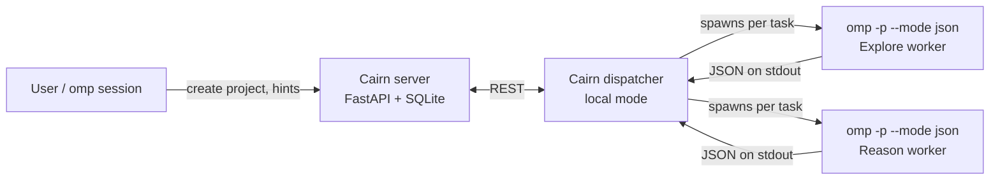

# Option C: run Cairn's own dispatcher with omp as the worker

Status: analysis only, nothing built.

The options weighed:

- **A.** keep the plugin as is (the omp controller agent decides what to do next);
- **B.** a light dispatcher inside the plugin that advises the controller (built: `src/dispatch.ts`);
- **C.** this document: Cairn's server and dispatcher drive the work, omp only executes tasks.

Cairn references are to the upstream project (`oritera/Cairn`). Anything not checked is marked **unverified**.

## 1. Why C is on the table

The plugin reproduces Cairn's data model and lease rules (facts, intents, hints, a Reason lease, intent leases with heartbeat and expiry), but not Cairn's dispatcher. In Cairn the dispatcher, not the model, decides when to reason and which intent to explore, and it is the only writer to the board. In the plugin, the controller agent has to remember to do all of that.

Observed in real sessions:

| Problem | Evidence |
|---|---|
| Agents stop writing to the board | A long session made no board call for about two hours and resumed only after a manual message. Another made 39 tool calls after `board_init` with no board write. |
| Intents written after the work | A production change ran before its intent was recorded. |
| One task split across two boards | A follow-up step was recorded on a new board with no facts, instead of continuing the original. |
| Wrong tool arguments | `board_complete` called without `worker`, twice across sessions. |

What works: when the prompt spells out every step, one controller plus two `task` subagents coordinate correctly. The two workers ran at the same time, each claimed its own intent, neither collided, and the controller completed the board. The board mechanics are sound; the weak part is who drives the loop.

## 2. How Cairn's dispatcher works

| Part | Behaviour | Source (upstream) |
|---|---|---|
| Server | FastAPI + SQLite; keeps the graph consistent, expires intent and Reason leases on heartbeat timeout | `cairn/src/cairn/server/services.py` (`expire_workers`, `expire_reason_leases`) |
| Dispatcher loop | Polls projects round-robin; runs Bootstrap on a new project; runs Reason when facts or hints grew, or the last open intent concluded; otherwise explores the newest unclaimed intent; caps concurrent tasks per project with `max_project_workers` | `dispatcher/scheduler/loop.py` (`_try_dispatch_project`, `_reason_trigger`) |
| Workers | Receive a prompt, return JSON. Reason: `{complete}` / `{intents}` / `{intent}`; Bootstrap: `{fact, complete?}`; Explore: `{description}` | `dispatcher/contracts.py` |
| Single writer | Only the dispatcher calls the server API; workers never write | `README.md` |
| Drivers | `claudecode`, `codex`, `pi`, `mock`; local mode runs the host CLI instead of a container | `dispatcher/workers/registry.py` |

## 3. What C would look like



omp would no longer coordinate. Each task becomes one non-interactive `omp -p` process whose stdout the dispatcher parses.

## 4. Compatibility of omp with Cairn's `PiDriver`

Cairn already has a driver for `pi`, the CLI omp descends from. Its local mode builds:

```
/bin/sh -lc 'mkdir -p "$sdir"; exec pi "$@"' -- <session_dir>
  --mode json --session-dir <dir> --no-extensions --no-skills --no-prompt-templates
  --no-themes --no-context-files --tools read,write,edit,bash,grep,find,ls [--session <id>] -p <prompt>
```

Compared with omp's `--help` and one real `omp -p --mode json` run:

| PiDriver expects | omp | Notes |
|---|---|---|
| binary `pi` | `omp` | `local_binary()` returns `"pi"` (hard-coded) |
| `--mode json` | yes | |
| `--session-dir` | yes | |
| `--session <id>` (continue a session) | **no**; omp has `--resume <id>` | used by `build_conclude` |
| `--no-extensions`, `--no-skills`, `--no-context-files` | yes | |
| `--no-prompt-templates`, `--no-themes` | **not in `omp --help`** | whether omp rejects unknown flags: **unverified** |
| `--tools read,write,edit,bash,grep,find,ls` | `--tools` yes | omp has `glob`/`find` and no `ls`; the effect of an unknown tool name: **unverified** |
| event `session` carrying the session id | yes | a real run emitted `session`, `turn_end`, `agent_end` |
| last assistant text in `agent_end.messages` | yes | a real run returned the text in `content` |

So a driver for omp is a small adaptation of `PiDriver` (binary name, `--resume`, dropped flags, tool list). Because omp is itself a fork of the same CLI line, this may be configuration plus a shim rather than a new driver: **unverified**.

## 5. Blockers and risks

1. **Windows.** Cairn supports macOS and Linux only. Local mode wraps every worker in `/bin/sh -lc` (`pi.py`, `_local_argv`). On Windows there is no `/bin/sh`, so local mode needs either a driver change that spawns the binary directly, or Git Bash (**unverified**). This is a blocker, not a detail.
2. **No authentication on the Cairn server.** There is no auth middleware; ownership is a plain `worker` name match (`routers/intents.py`). Anyone who can reach the port can claim, conclude or release any intent. The server must stay on loopback or behind an authenticated tunnel, and must never be exposed directly.
3. **AGPL-3.0.** Running Cairn locally is fine. The plugin is MIT and must not copy Cairn code; a change inside Cairn would fall under AGPL if distributed.
4. **Two sources of truth.** C stores the graph in Cairn's SQLite, not in the plugin's boards. The plugin's viewer, `board_list`, compaction pointer and reminder would not see Cairn projects unless the plugin reads Cairn's database or API.
5. **Each task is a cold process.** Workers start without the user's session context, instructions, skills or extensions (the driver disables them). This is Cairn's design, but it fits open-ended search, not interactive work where a user steers one session.
6. **Cost and latency.** Every Reason and Explore is a separate model run; Reason runs again whenever facts or hints change.

## 6. Work items if C is chosen

1. Add an omp driver in the Cairn checkout, derived from `PiDriver`: binary `omp`, `--resume` instead of `--session`, drop unsupported flags, map the tool list.
2. Decide the Windows path (WSL, or a driver that does not need `/bin/sh`).
3. Run the server on loopback only.
4. Decide how the plugin relates to Cairn: ignore it, read Cairn's API in the viewer, or mirror projects into boards.
5. Acceptance test: two independent questions; check that Reason creates the intents, two Explore workers run in parallel, Reason completes, and no step needs a human prompt.

## 7. Comparison

| | A. as is | B. light dispatcher (built) | C. Cairn dispatcher |
|---|---|---|---|
| Who decides the next step | the agent | the agent, prompted by the plugin | Cairn's code |
| Single writer | no | no | yes |
| Works in an interactive omp session | yes | yes | no (headless workers) |
| Runs on Windows as shipped | yes | yes | no |
| New moving parts | none | one hook | a server, a dispatcher, a driver |
| Board seen by the plugin viewer and tools | yes | yes | no, unless bridged |

B fits interactive sessions; C fits batch searches started from an origin and a goal and left to run. They are not exclusive.

## 8. Measurements

- **Parallel coordination (one run, one model):** the controller and two subagents completed the work with no collision (see section 1).
- **Dispatcher advice (one run, one model):** when the prompt only said to create intents and follow the dispatcher's messages, the dispatcher asked for Explore workers and then a Reason pass, and the controller followed both. The prompt primed the agent to read those messages, so this shows B can lead, not that it always will. A cleaner test would stop the prompt at `intent_create` and check whether the advice alone triggers the spawn.
